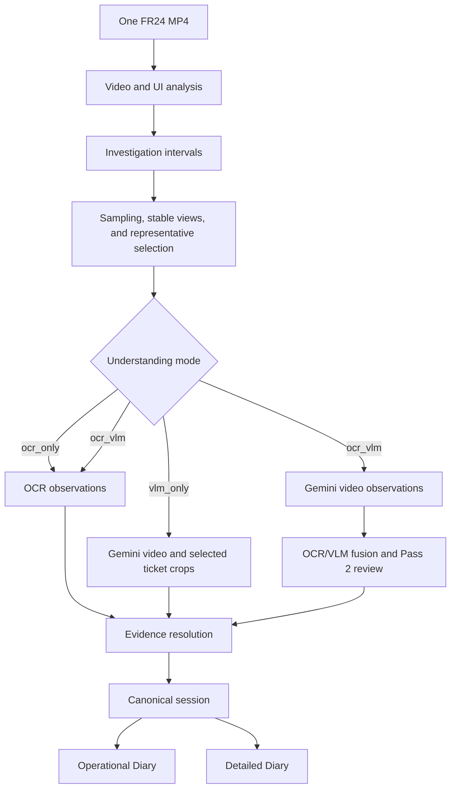

# Events Diary

Events Diary turns a Flightradar24 (FR24) screen recording into two text reports: a concise Operational Diary and a more detailed Diary. It detects aircraft Investigations, selects ticket evidence, reads visible ticket fields, records visual route context, and renders resolved observations while preserving their sources and uncertainty.

The current MVP is designed for local processing of one video at a time. Investigation detection and evidence selection are deterministic; OCR and the configured Gemini VLM provide separate observations that are resolved into a canonical session before rendering.

## How it works



The video/UI stage uses the FR24 layout model, visual change, map and route evidence, ticket scrolling, and Investigation lifecycle analysis. For each Investigation, adaptive sampling and stable-view analysis identify representative physical frames. OCR and VLM observations retain separate provenance. In combined mode, the VLM's first pass receives the Investigation video without OCR values; fusion and a later review pass then cross-check the sources. Unavailable, unresolved, conflicting, and inferred information remains distinguishable during resolution.

## Understanding modes

Set `EVENTS_DIARY_UNDERSTANDING_MODE` to one of:

| Mode | Behavior |
| --- | --- |
| `ocr_vlm` | Default. Runs OCR and VLM branches, fuses their observations, and uses a VLM review pass before resolution. |
| `ocr_only` | Reads selected ticket representatives with OCR and resolves OCR evidence without Gemini. |
| `vlm_only` | Uses the continuous Investigation clip and selected ticket crops with Gemini; it does not run OCR or fusion. Successful Investigations can be retained when another Investigation fails. |

In `ocr_only` and `ocr_vlm`, a failed Investigation prevents diary files from being written. In `vlm_only`, output can be `completed`, `partial`, or `failed`; per-Investigation failures are represented without inventing field values.

## Requirements and setup

- Python 3.10 or newer
- [uv](https://docs.astral.sh/uv/)
- A Gemini API key for `ocr_vlm` and `vlm_only`

Install the development and OCR dependencies:

```bash
uv sync --group dev --group ocr-calibration
```

Copy `.env.example` to `.env` and set the configuration for your run. Provide the API key in `.env` for VLM modes; never commit that file. The template uses `gemini-flash-latest` as its model setting. Provider access, model availability, quotas, and request costs are controlled by Google and may change.

| Variable | Purpose | Default |
| --- | --- | --- |
| `EVENTS_DIARY_UNDERSTANDING_MODE` | Pipeline mode: `ocr_only`, `vlm_only`, or `ocr_vlm` | `ocr_vlm` |
| `EVENTS_DIARY_VLM_PROVIDER` | VLM provider | `gemini` |
| `EVENTS_DIARY_VLM_API_KEY` | Gemini API key; required for VLM modes | unset |
| `EVENTS_DIARY_VLM_API_BASE_URL` | Gemini API base URL | `https://generativelanguage.googleapis.com` |
| `EVENTS_DIARY_VLM_API_VERSION` | Gemini API version | `v1beta` |
| `EVENTS_DIARY_VLM_MODEL` | Gemini model name | `gemini-flash-latest` |
| `EVENTS_DIARY_VLM_REQUEST_TIMEOUT_S` | Per-request timeout in seconds | `180` |
| `EVENTS_DIARY_VLM_MAX_ATTEMPTS` | Maximum request attempts | `3` |
| `EVENTS_DIARY_VLM_RETRY_BASE_DELAY_S` | Retry backoff base in seconds | `5` |
| `EVENTS_DIARY_VLM_RETRY_MAX_DELAY_S` | Maximum retry backoff in seconds | `60` |
| `EVENTS_DIARY_VLM_RETRY_JITTER_S` | Retry jitter in seconds | `1` |

The OCR path uses RapidOCR with ONNX Runtime on CPU. The VLM path sends Investigation video inline to Gemini and currently enforces a 20 MiB video-file limit. VLM requests are subject to provider availability, quotas, and transient failures.

## Run

Place exactly one `.mp4` video directly in `experiment/input/`, then run:

```bash
uv run python -m events_diary
```

The input selector examines files directly in that directory (not nested folders) and reports an error if it finds no MP4 or more than one. The pipeline assumes FR24 UI regions and supports the canonical 1920×1080 layout plus proportional layouts with the same aspect ratio. Cropped or incompatible layouts may not be interpreted correctly.

Successful runs write:

| Path | Contents |
| --- | --- |
| `experiment/output/operational_diary.txt` | Concise event-oriented report |
| `experiment/output/detailed_diary.txt` | Detailed report with available ticket and visual context |
| `experiment/output/vlm_run_results.json` | Per-Investigation VLM-only results and sanitized failures; written in `vlm_only` mode |

The canonical session and OCR/VLM/fusion intermediate observations are held in memory. The combined `ocr_vlm` mode does not currently write those intermediate records as separate artifacts. Temporary per-Investigation clips and crops are cleaned up after processing. Generated input and output contents are intended to remain local and are ignored by Git.

## Development checks

```bash
uv run pytest
uv run ruff check .
```

## Repository map

```text
docs/                 System design and project plan
scripts/              Validation, calibration, and debug utilities
src/events_diary/     Detection, evidence preparation, OCR, VLM, fusion,
                      resolution, canonical data, and rendering modules
tests/                Unit and integration tests
experiment/input/     Local input-video workspace
experiment/output/    Generated diary workspace
data/                 Local media and diagnostic artifacts, where applicable
```

See [system design](docs/system_design.md) for architecture and [project plan](docs/project_plan.md) for project status and planned work.

## Scope and limitations

This is an FR24-focused MVP, not a general-purpose video understanding tool or a labeled accuracy benchmark. OCR quality depends on visible text, selected frames, and ticket layout; VLM extraction can also make field errors. UI thresholds and evidence-selection behavior are based on representative manual validation and remain subject to refinement. Real-video validation has exercised the end-to-end OCR/VLM path, but results do not imply uniform accuracy across recordings. Gemini runs require external connectivity and are subject to provider-side availability and quotas.
