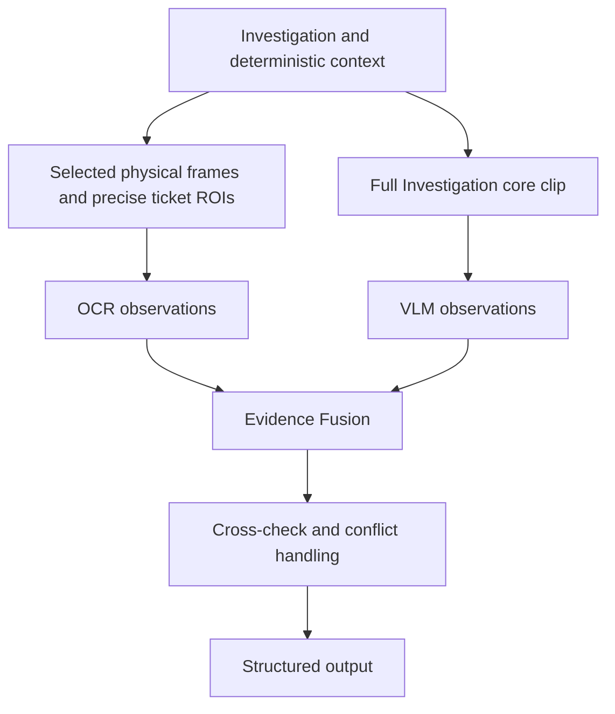

# Events Diary — System Design

## 1. Purpose

Events Diary is a local visual-intelligence system for analyzing short Flightradar24 screen recordings and converting them into a structured aircraft event journal.

The system is designed to understand what an operator investigated on screen, extract relevant information from the Flightradar24 interface, infer missing information only when evidence supports it, and produce both machine-readable and human-readable outputs.

The initial target is short recordings of approximately 30–40 seconds, but the architecture should remain scalable to longer sessions.

---

## 2. Core Product Concept

The fundamental unit of operator activity is an **Investigation Event**.

An Investigation Event represents a period during which the operator focuses on a selected aircraft and inspects its information.

The same aircraft may be selected more than once during a video. These separate Investigation Events can later be grouped under a single **Tracked Aircraft Entity**.

Example:

```text
event_001 → UAL84
event_002 → DL152
event_003 → UAL84
```

This represents:

- 3 Investigation Events
- 2 Tracked Aircraft Entities

The system must preserve both perspectives:

1. chronological operator activity;
2. aircraft-level aggregation.

---

## 3. Main Inputs and Outputs

### Input

Initial MVP input:

```text
Short Flightradar24 screen recording
```

Typical characteristics:

- approximately 30–40 seconds;
- north-up map;
- no map rotation;
- zoom and pan may occur;
- many aircraft may be visible simultaneously;
- one aircraft is selected at a time;
- the information ticket appears on the left side;
- the ticket can be vertically scrolled;
- the right side of the map is useful visual evidence;
- no advertisement region needs to be excluded.

### Outputs

The system produces one canonical session representation and renders multiple user-facing outputs from it.

Planned outputs:

```text
session.json
operational_log.txt
detailed_report.txt
optional debug artifacts
```

The JSON is the source of truth. Text outputs are renderings of that structured record.

---

## 4. Design Principles

### 4.1 Evidence-first

The system must distinguish clearly between:

- information directly visible on screen;
- semantic enrichment;
- inference.

The system must never silently invent missing information.

Unknown values are valid outputs.

### 4.2 Deterministic methods first

Computer vision, OCR, geometry, temporal reasoning, and explicit system rules should handle tasks that can be solved reliably without a VLM.

The Gemini VLM branch independently analyzes the complete continuous Investigation
video. It complements deterministic/OCR evidence without changing their
responsibilities.

### 4.3 VLM as assistant, not authority

The VLM can help with:

- difficult visual text;
- semantic enrichment;
- aircraft/livery interpretation;
- ambiguous visual evidence;
- final Investigation-level cross-checking.

OCR and VLM produce separate observation streams for later fusion and cross-check.
Neither branch directly overwrites the other's output or the structured record.
Neither branch's execution depends on the other's output.

### 4.4 Modular implementation

Each phase should have a narrow responsibility and clear inputs/outputs.

Avoid:

- large catch-all modules;
- speculative abstractions;
- unnecessary class hierarchies;
- premature support for hypothetical models.

### 4.5 Configuration-driven behavior

Thresholds, ROI coordinates, sampling parameters, model settings, and other tunable behavior should live in configuration rather than being scattered through code.

### 4.6 Incremental validation

Every phase must be tested independently and then tested as part of the cumulative pipeline.

---

# 5. Evidence Model

Each meaningful extracted field should carry provenance and confidence information.

## 5.1 Field Status

Conceptual statuses:

```text
OBSERVED
ENRICHED
INFERRED
EXPLICIT_NA
UNREADABLE
NOT_PRESENT
AMBIGUOUS
CONFLICT
```

Meaning:

- **OBSERVED** — directly supported by visual evidence.
- **ENRICHED** — semantic expansion of observed information.
- **INFERRED** — derived from indirect evidence.
- **EXPLICIT_NA** — UI explicitly displays an unavailable value.
- **UNREADABLE** — field appears present but cannot be read reliably.
- **NOT_PRESENT** — field is not visible in available evidence.
- **AMBIGUOUS** — multiple plausible values remain.
- **CONFLICT** — strong evidence sources disagree.

## 5.2 Confidence

User-facing confidence should remain qualitative:

```text
HIGH
MEDIUM
LOW
```

Avoid presenting fake numerical precision. Preserve source-specific raw confidence
where available, but do not treat OCR confidence, model-reported confidence,
geometric response and raw image-quality diagnostics as interchangeable scores.

## 5.3 Provenance

Possible evidence/source classes include:

```text
OCR
VLM_OBSERVATION
VLM_INTERPRETATION
CV_GEOMETRY
ROUTE_INFERENCE
AIRCRAFT_IMAGE
SYSTEM_RULE
```

OCR and VLM observations remain separate until fusion. VLM provenance records the
actual configured Gemini model and source identity.
Supplied deterministic guidance is not independently VLM-observed evidence.
Clip-level evidence may have only a time range; never invent frame precision.
Observed information remains distinct from unsupported inference or enrichment.
Fusion retains conflicting observations and their provenance rather than silently
overwriting a source.

---

# 6. Ticket Model

The Flightradar24 ticket on the left side is a dynamic scrollable viewport.

The outer panel may remain spatially stable, but the content inside it can change due to scrolling.

Therefore the system must not assume that every ticket field exists in a fixed vertical ROI.

## 6.1 Scroll behavior

Ticket scrolling:

- does not create a new Investigation Event;
- should trigger dense evidence sampling;
- should preserve stable scroll stops;
- may reveal additional fields that were not visible in the initial ticket view.

Two frames with different ticket scroll positions are not duplicates if they reveal different information.

## 6.2 Ticket information

The canonical record should contain normalized core fields and allow additional ticket data.

Examples of useful ticket fields:

```text
flight number
airline
origin
destination
scheduled time
estimated time
registration
aircraft type
altitude
vertical speed
ground speed
track
ICAO 24-bit address
squawk
latitude / longitude
data source
aircraft serial
aircraft age
aircraft category
```

The system should not discard fields simply because they are not part of the concise operational log.

A flexible `ticket_sections` structure should retain additional information.

---

# 7. Phase Architecture

## Phase 0 — Project Foundation

Purpose:

Build a clean, reproducible Python project before implementing visual logic.

Responsibilities:

- Python environment;
- `uv`;
- package structure;
- pytest;
- Ruff;
- configuration foundation;
- logging foundation;
- central API-based VLM configuration;
- first application entry point.

No Flightradar24 visual logic should be implemented here.

---

## Phase 1 — Video Decode & Time-Based Sampling

Purpose:

Create a reliable representation of the source video and sample it in time.

Responsibilities:

- decode metadata;
- duration;
- source FPS;
- resolution;
- frame count;
- timestamps;
- time-based frame sampling.

Timestamps are primary.

Frame index divided by FPS is only an approximation.

The sampling rate should be empirically selected based on the shortest meaningful operator action that must be detected.

Candidate test rates:

```text
1 FPS
2 FPS
4 FPS
8 FPS
```

Important cases:

- variable frame rate;
- changing video resolution;
- corrupted frame;
- video begins during an active Investigation;
- video ends during an active Investigation.

Frames should not be permanently stored unless needed as evidence or debug output.

---

## Phase 2 — UI Regions & Change Features

Status: COMPLETE (2.1-2.5). Phase 3 consumes this completed visual foundation.
Phase 2 measures visual evidence and interprets active scroll motion; it does not
make Investigation decisions or extract semantic ticket/aircraft information.

### UI / ROI layer (2.1)

`config.py` defines frozen `UIConfig` and rectangular `ROI` objects against the
canonical 1920x1080 layout. `ROI.crop()` uses exclusive right/bottom boundaries
and rejects out-of-frame crops. Existing canonical regions include:

| Region | x | y | Width | Height |
|---|---:|---:|---:|---:|
| `map_analysis_region` | 352 | 121 | 1568 | 919 |
| `ticket_header` | 16 | 121 | 336 | 76 |
| `aircraft_image` | 16 | 197 | 336 | 189 |
| `ticket_scroll_body` | 16 | 386 | 336 | 566 |

`layout.py` classifies exact-reference, proportional-scale, and partial/cropped
layouts. `map_roi_to_frame()` maps compatible layouts proportionally and rejects
partial/cropped layouts. Explicit `LayoutTransform` scale/offsets can instead be
supplied to `map_roi_with_transform()`, which retains unrounded bounds, a visible
crop, and FULL/PARTIAL/OUTSIDE visibility. This supports supplied transforms for
cropped layouts without claiming automatic layout recovery. Current motion APIs
with canonical UIConfig and real-video evaluators require exact reference geometry.

`UIConfig.map_ignore_masks` contains four full-frame rectangles: top FR24 strip
`(352,121,1568,60)`, right controls `(1856,284,60,218)`, bottom toolbar
`(746,958,428,70)`, and attribution/footer `(1480,1024,440,16)`. These exclude SIFT
feature centers only. They do not mask raw or aligned pixel metrics, and there
are no aircraft/route/geographic exclusion categories.

### Basic visual change layer (2.2)

`change_metrics.py` accepts nonempty matching uint8 grayscale or three-channel BGR
arrays. BGR is converted to grayscale, and OpenCV absolute difference avoids
unsigned subtraction wraparound. No resizing, filtering, or normalization occurs.

- `compute_mad()` returns mean absolute grayscale difference in intensity units
  (0-255).
- `compute_changed_pixel_ratio()` returns the fraction of pixels whose difference
  is strictly greater than `pixel_threshold`. Its current default is **10**, an
  experimental working value; callers may explicitly override it within 0-255.

These measurements carry no semantic interpretation. Equal-grayscale color changes
may be missed, while noise and motion can cause changes. SSIM is intentionally
deferred and is not part of the completed Phase 2 production implementation.

### Map motion compensation (2.3)

`estimate_map_motion()` in `map_motion.py` returns frozen `MapMotionEstimate`
evidence, including validity/reason, B-to-A dx/dy/scale/rotation, feature/match/inlier
counts, inlier ratio, raw MAD/CPR, and optional aligned MAD/CPR.

The deterministic pipeline detects SIFT features, matches B descriptors against A
with BF L2 KNN (`k=2`), applies Lowe's ratio test, and fits a RANSAC partial-affine
transform. Working values are Lowe ratio 0.75, minimum 10 good matches, 8 inliers,
inlier ratio 0.50, scale range [0.5,2.0], and rotation tolerance 3 degrees. RANSAC
uses a 3-pixel reprojection threshold, 2000 maximum iterations, 0.99 confidence,
and 10 refinement iterations. These are provisional, not production calibration.

From the fitted matrix `[[a,-b,tx],[b,a,ty]]`, derive scale `hypot(a,b)`, rotation
`degrees(atan2(b,a))`, dx `tx`, and dy `ty`. The intended north-up model supports
translation plus uniform scale. Rotation is retained diagnostically and checked
for validity; accepted rotation is excluded from the alignment warp.

When `ui_config` is supplied, full-frame ignore rectangles subtract the map origin
(352,121) to build a map-local uint8 SIFT mask (255 allowed / 0 excluded). Inputs
must match canonical crop dimensions. Generic calls without configuration remain
unmasked. Input image pixels are never changed by detection masks.

Map B is warped into Map A using `[[scale,0,dx],[0,scale,dy]]` with linear
interpolation. An all-ones support image is warped identically; only pixels with
full source support enter aligned MAD/CPR through the existing metric APIs.
Artificial padding is excluded. Raw metrics cover the whole crop, so their domain
differs from aligned overlap. Invalid fits retain raw metrics and an explanatory
reason, with aligned metrics unavailable. Missing descriptors, weak matches or
inliers, failed/non-finite transforms, implausible scale/rotation, and empty overlap
are rejected rather than forced into a result.

Engineering conclusion: **dense consecutive-source-frame analysis is the preferred
production approach for map motion**. Large distant-frame displacement can reduce
geographic feature overlap; static overlays also previously dominated the distant
pan fit. SIFT masking removes static UI feature centers but cannot recover missing
geographic overlap. Adjacent-frame comparisons preserve overlap better.
This is an input-selection conclusion, not a new detector or fallback algorithm.

Real-video validation confirmed meaningful pan translation with near-unit scale
and coherent zoom scale changes. Some weak zoom fits may be rejected. Residual MAD may rise
after interpolation/re-rendering even when CPR improves; validity does not prove
that global motion explains every visual change.

### Ticket scroll analysis (2.4)

`estimate_ticket_scroll_evidence(frame_a, frame_b, ui_config)` accepts full matching
canonical uint8 grayscale/BGR frames. Frozen `TicketScrollEvidence` contains:
`header_mad`, `header_cpr`, `aircraft_image_mad`, `aircraft_image_cpr`, `body_mad`,
`body_cpr`, `map_mad`, `map_cpr`, `dx`, `dy`, and `motion_response`.

All four ROIs reuse existing MAD/default CPR. Only `ticket_scroll_body` supplies
motion: grayscale float32 arrays, a Hann window, and `cv2.phaseCorrelate()`.
Displacement is **A-to-B**, right/down positive, opposite to map compensation's
B-to-A convention. dx/dy are not clipped; response is diagnostic without a
reliability threshold. Repetitive or textureless content and large shifts can
produce unreliable motion even with finite values.

`is_vertical_scroll_evidence()` requires all inclusive working conditions:
body CPR >=0.10, |dy| >=2 pixels, |dy| >=3*|dx|, and each header/image/map CPR <=0.01.
These defaults are provisional, informed by one recording and simple margins;
vertical dominance is especially uncalibrated. Non-finite decision inputs fail.
A positive pair is evidence only, not a temporal event or Investigation decision.

`analyze_ticket_scroll_sequence()` consumes those records without recomputing
pixels or motion. It returns one `TicketScrollState` per input pair:
`QUIET="quiet"`, `SCROLLING_UP="scrolling_up"`, or
`SCROLLING_DOWN="scrolling_down"`. Provisional defaults are window_size=5,
min_positive_pairs=2, max_gap_pairs=1. Positive pairs form candidate spans across
at most one False gap; longer gaps split spans. Centered offline windows are
clipped to each span and sequence boundary, require two positives, and use only
positive dy signs for direction. Ties are QUIET; no leading/trailing quiet extension
occurs. Future pairs are used, so this is not a causal streaming API.

Scrolling states represent detected active motion in the current context, not the
entire human scrolling interaction. Short or longer pauses may legitimately be
QUIET between bursts. A future "recently scrolling" cooldown or broader interaction
context belongs to a higher-level consumer such as Phase 3 Investigation Detection,
rather than artificial extension of these states. No scroll-event objects,
start/end timestamps, or Investigation decisions are created.

### Real-video validation and closure (2.5)

`scripts/validation/validate_phase2.py` exercises both pipelines on consecutive decoded frames
at source FPS, with explicit EOF/count/layout validation.
Manual evaluation scripts retain source indices and nominal index/FPS times;
constant-FPS assumptions and metadata-count limitations remain explicit.

Closure validation confirmed these architectural conclusions:

- Pan estimation captures meaningful translation while scale remains near one.
- Zoom estimation shows coherent scale changes, with occasional rejected weak fits.
- Ticket-scroll evidence and temporal states capture the correct vertical direction
  during active motion; quiet intervals and pauses remain quiet.
- Cross-phenomenon checks showed no problematic confusion between map motion and
  ticket scrolling in the representative recordings.
- Tests and lint passed at closure; no new production issue was observed.

This representative manual validation is not an accuracy benchmark. Detailed
measurements belong in the local validation report. Videos, CSVs, and debug images
remain local ignored evaluation evidence, not committed architecture artifacts.

### Phase 2 output contract for Phase 3

Phase 2 provides UI-region change signals, geometric map-motion estimates with
validity/rejection diagnostics, raw/aligned visual metrics, pair-level ticket-scroll
evidence, and temporal active-scroll state. These validated signals can support
inclusion, exclusion, or contextual reasoning by Phase 3. They are not semantic
proof of aircraft identity, route changes, or an Investigation boundary. Consumers
must preserve unavailable estimates, coordinate conventions, and metric domains.

Known limitations remain: provisional thresholds, possible rejected zoom pairs,
interpolation residuals, active-motion rather than whole-interaction scroll state,
frame-rate-dependent temporal context, and no automatic layout recovery. Phase 2
is COMPLETE; Phase 3 now consumes these measurements in separate signal, candidate,
confirmation, and lifecycle layers. Phase 4 prepares evidence requests; Phase 5
materializes and selects those requests for downstream consumers.

---

## Phase 3 — Investigation Event Detection

Status: COMPLETE (3.1-3.6). The completed offline pipeline is:

```text
video frames
-> single-frame Investigation presence
-> bounded transient-absence bridge / effective presence
-> pair-level InvestigationSignals
-> OPEN / SWITCH / CLOSE / NONE candidates
-> temporal confirmation
-> Investigation lifecycle intervals
```

The layers distinguish current visual presence, pair changes, candidate hypotheses,
confirmed events, and lifecycle state. None establishes aircraft identity or
extracts ticket content. Existing Phase 2 coordinate conventions and unavailable
measurements remain explicit.

### Presence and pair signals (3.1)

`investigation_signals.py` separates single-frame presence ("What exists now?")
from pair-level changes ("What changed?"). Frozen `InvestigationPresenceEvidence`
measures dark occupancy in `ticket_bottom_actions`, Canny edge occupancy in
`ticket_scroll_body`, and diagnostic body light occupancy. The presence classifier
requires bottom darkness and body structure; brightness is not required. Some
dimmed/loading frames can nevertheless fail the raw structural thresholds.
Effective presence can bridge a bounded transient absence without changing those
raw measurements. Presence does not mean content has finished loading or that a
new Investigation began.

`analyze_investigation_pair()` orchestrates existing APIs into immutable
`InvestigationSignals`. Header, aircraft image, and ticket body use grayscale
MAD/CPR and `ChangeSignal` strengths: NOT_AVAILABLE, LOW, MEDIUM, HIGH. Strength is
CPR-based visual-change magnitude, not confidence. Aligned map residual is
supporting/context evidence; rejected or unavailable alignment stays NOT_AVAILABLE
without raw fallback. The original map-motion record retains diagnostics.

`route_selection.py` compares provisional route-colored masks after B-to-A
translation/scale compensation on fully supported overlap. Its pair classifier
requires both additions and removals, distinguishing replacement from initial
appearance. Color evidence does not establish route geometry, ownership, or
identity. Existing ticket-scroll evidence and its pair classifier remain separate,
with A-to-B motion semantics and no TicketScrollState in InvestigationSignals.

### Pair-level candidates (3.2)

`investigation_detection.py` returns frozen `InvestigationCandidate` records with
kind and deterministic reason. MEDIUM/HIGH header/image/body changes are meaningful;
LOW/NOT_AVAILABLE do not vote. Raw presence is classified internally for both
frames; callers may supply effective presence for temporal interpretation.

| Presence transition | Candidate rule |
|---|---|
| False -> False | NONE |
| False -> True | OPEN with at least two meaningful ticket signals; otherwise NONE |
| True -> False | CLOSE |
| True -> True | SWITCH with route replacement and at least one meaningful ticket signal, or two during meaningful map motion; otherwise NONE |

Scroll is context, not a global veto. Generic map residual, translation, scale,
and rotation are not positive votes. A candidate is a pair hypothesis, not a
confirmed event or lifecycle transition.

### Offline temporal confirmation (3.3)

`investigation_temporal.py` consumes consecutive semantic `CandidateTimelineEntry`
records without rerunning CV. A provisional **0.7-second** future look-ahead window
requires timestamp coverage and consistent sampled presence: True for OPEN/SWITCH,
False for CLOSE. NONE is neutral; repeated identical candidates are not required.
ANY later non-NONE candidate through the inclusive horizon supersedes the earlier
candidate, including the same kind. Semantic candidate merging is not implemented.

Each non-NONE candidate receives CONFIRMED, SUPERSEDED, or
INSUFFICIENT_FUTURE_CONTEXT. Only confirmed OPEN/SWITCH/CLOSE become
`ConfirmedInvestigationEvent` records. Early video endings do not shorten the
window. Full-coverage presence reversal without an associated candidate is an
explicit ambiguity error rather than an invented rejection status.

`candidate_time_seconds` is the original pair's after-frame event-time estimate.
`confirmed_at_seconds` is that time plus the look-ahead horizon, recording when
sufficient context is available. It must never replace the event timestamp.
Chronological consecutive coverage and shared-frame presence are validated.
This is offline confirmation, not streaming detection.

### Lifecycle construction (3.4)

`investigation_lifecycle.py` consumes initial presence, confirmed semantic events,
and video bounds only. Its states are NO_INVESTIGATION and ACTIVE_INVESTIGATION;
candidates/loading are not lifecycle states. Initial presence starts an interval
at video start with VIDEO_STARTED_ACTIVE, without inventing an OPEN event.

| State | Confirmed event | Lifecycle behavior |
|---|---|---|
| NO_INVESTIGATION | OPEN | Start with OPEN reason |
| NO_INVESTIGATION | SWITCH | Start with SWITCH reason; intentionally valid |
| NO_INVESTIGATION | CLOSE | Remain inactive and record a diagnostic anomaly |
| ACTIVE_INVESTIGATION | SWITCH | End with SWITCH and start a replacement at the same time |
| ACTIVE_INVESTIGATION | OPEN | End with OPEN_REPLACEMENT and start with OPEN at the same time |
| ACTIVE_INVESTIGATION | CLOSE | End with CLOSE and become inactive |

Visual candidate semantics can differ from lifecycle state. NO + SWITCH is valid
when an accidental opening was superseded but a later present ticket supplies a
confirmed SWITCH. Superseded candidates never enter lifecycle construction.

All interval boundaries use candidate times. An interval active at video end
closes with VIDEO_END at the supplied video end time. Equal event timestamps
preserve input order and may yield zero-duration intervals; no artificial gap is
introduced at replacement. Invalid order/bounds/kinds are rejected. Inactive CLOSE
anomalies are diagnostic and do not stop processing.

### Phase 3 output contract and closure (3.5)

Phase 3 produces ordered frozen `InvestigationInterval` records containing a
contiguous investigation index, start/end seconds, and start/end reasons, plus
lifecycle anomaly diagnostics. Start reasons are VIDEO_STARTED_ACTIVE, OPEN, and
SWITCH; end reasons are CLOSE, SWITCH, OPEN_REPLACEMENT, and VIDEO_END. These
intervals are the semantic input for Phase 4's evidence preparation and
adaptive sampling. They contain no aircraft identity, OCR content, selected frames,
route data, confidence, or canonical final JSON.

Closure validation runs the complete production pipeline on representative
opening/switch, startup-active, and close/no-ticket/reopen recordings. It confirms
candidate-time boundaries, startup-active handling, temporal superseding of a short
accidental opening, inactive gaps, and coherent lifecycle intervals without
unexpected anomalies. Tests, lint, and closure scenario/invariant checks passed.
Detailed measurements stay in local validation reports, not this architecture.

Thresholds and the confirmation window remain provisional, derived from a small
real-video set rather than a benchmark. Known limitations include limited negative
background/theme coverage for presence, ambiguous partial loading, color-mask
false positives, poorly calibrated generic map residual, and sampled rather than
continuous presence. Evaluators require canonical geometry and assume constant FPS
for nominal index/FPS timestamps. Temporal coverage ends at the last sample;
lifecycle VIDEO_END uses full nominal metadata duration. No identity, content
extraction, automatic layout recovery, or online lifecycle is implemented.

### Regression hardening (3.6)

During meaningful valid map motion (translation magnitude greater than 1 pixel or
scale delta greater than .01), SWITCH requires two of the three MEDIUM/HIGH
header, aircraft-image, and ticket-body signals, alongside route replacement.
Otherwise one ticket signal is sufficient. This reduces route-mask cross-talk
during pan without imposing a blanket motion veto. Simultaneous real selection
and substantial map motion still needs validation.

The offline transient-absence bridge fills only bounded absent runs between
present samples when recovery occurs within a provisional .15 seconds of the
first absent sample. Leading, trailing, and longer absences remain unchanged.
Raw presence evidence is retained separately; effective presence drives candidates,
confirmation, and stable-view interpretation. Genuine very short close/reopen
interactions remain an explicit validation gap. Regression footage preserves the
real close boundary and aircraft replacement while removing a false pan SWITCH.

Phase 3 is COMPLETE. Phase 4 consumes its lifecycle and effective presence.

---

## Phase 4 — Investigation Extraction & Adaptive Sampling

Status: COMPLETE (4.1-4.5). These stages prepare immutable evidence requests and
annotations without selecting final frames. The completed Phase 5 consumes them
for physical resolution and reference selection.

```text
Phase 3 lifecycle / effective presence
-> InvestigationInterval
-> InvestigationWindow
-> AdaptiveSamplingPlan
-> TicketStableView
-> EvidenceCandidate timeline
```

### Investigation windows (4.1)

`investigation_window.py` preserves each lifecycle interval's core boundaries and
index. Fixed provisional .5-second context before and after is clipped to video
bounds. Windows may overlap and are not merged; contextual overlap does not
change Investigation ownership. Window construction does not decode video.

### Adaptive sampling (4.2)

`adaptive_sampling.py` consumes existing pair signals directly, without an
ActivityLevel abstraction. Provisional dense triggers are detected ticket scroll,
route visual change, MEDIUM/HIGH header, aircraft-image or ticket-body change,
valid map translation magnitude greater than 1 pixel, and valid scale delta
greater than .01. Map residual alone and rotation do not trigger dense sampling.
Route visual change describes mask change, not aircraft identity, and can
cross-trigger during map motion.

Trigger pairs expand by .5 seconds before and after, clip to the window, and
merge when overlapping or touching. This interval merging supplies hysteresis.
Sparse sampling uses a window-start-anchored 1 FPS grid outside inclusive dense
intervals. Dense sampling uses an interval-start-anchored source-FPS grid and
retains interval endpoints. Window start/end and Investigation start/end are
always preserved as exact semantic anchors. Dense reasons retain deterministic
order and provenance.

Requested timestamps are not yet decoded frame identities. Floating-point
boundary tolerance is absolute 1e-9 seconds; distinct semantic anchors remain
distinct even when closer than this tolerance. Off-grid interval endpoints and
anchors can add requests beyond a nominal duration-times-FPS count. No target
reduction is imposed on prolonged real activity.

### Stable ticket views (4.3)

`ticket_stable_views.py` interprets continuous, consecutive pair evidence inside
the Investigation core. Stability requires effective presence, no detected scroll,
and LOW ticket-body change continuously for a provisional .5-second dwell. It
adds no header/image gate or extra pixel threshold. Confirmation records the dwell
boundary once sufficient observed coverage exists; no sample must fall exactly
on that boundary.

Every qualifying maximal span is retained, including intermediate reading pauses
and ordinary stable tickets. Scroll, body change, or presence loss ends a span.
An ongoing final span is right-censored (`end=None`) when observation ends before
the known core end. Post-scroll provenance retains the prior scroll end and
direction where available; short pauses below dwell do not create stable views.
Mixed or unavailable direction stays unknown.

Stable views complement dense moving evidence; they do not replace it. LOW body
change does not establish semantic completeness, new content, or reading intent.
Slow cumulative drift and reversals without a stable pause remain validation gaps.
This stage does not perform OCR or select ticket sections.

### Evidence candidate timeline (4.4)

`evidence_candidate_timeline.py` composes each plan and its stable views without
rerunning CV or decoding. Every requested timestamp becomes exactly one immutable
candidate, preserving timestamp values and order. No timestamp is synthesized,
ranked, filtered, or merged. Every candidate has exactly one sparse/dense sampling
label; dense reasons, coincident anchor labels, and stable-view semantics coexist.

Stable spans annotate existing requests, including their pre-confirmation portion.
Right-censored spans end at the core boundary for association and cannot annotate
trailing context. Membership must be unambiguous and every stable view must have
candidate coverage. Invalid ownership, overlapping spans, inconsistent provenance,
or uncovered views raise errors. Upstream windows, plans, and views remain intact.

### Validation and Phase 5 contract (4.5)

The closure validator reuses shared evaluation preparation and production APIs
across representative lifecycle, scroll, pan, zoom, and combined recordings.
It checks interval preservation, exact request-to-candidate correspondence,
sampling/reason consistency, anchors, stable coverage, post-scroll provenance,
moving-scroll retention, and Phase 3 regressions. Detailed per-recording results
belong in local reports. This is manual representative validation, not a benchmark.

Closure checks, required production evaluators, tests, and lint passed. Validation
preserved the combined lifecycle, dense scrolling and pan, stable reading pauses,
post-pan sparse coverage, and actual replacement anchors. Pan activity was
translation-led; zoom showed scale activity with route-mask cross-talk and long
dense coverage. No sampling or detection defaults were retuned.

Phase 4 outputs Investigation windows, adaptive requested timestamps, stable-view
annotations, and unified evidence candidates. Phase 5 receives these records for
physical materialization and role-based representative selection. Those operations
are implemented separately in Phase 5; Phase 4 requests and annotations remain
unchanged. OCR, semantic ticket deduplication and final ticket-section extraction
remain future work.

Thresholds remain provisional. Validation is mostly canonical 1920x1080, 10 FPS,
and one FR24 environment; higher FPS and other layouts need validation. Automatic
layout recovery is unavailable. Dense volume can remain high during prolonged
activity. These limitations also retain the Phase 3 simultaneous-motion selection
and short close/reopen gaps described above.

---

## Phase 5 — Role-Based Frame & Ticket-Section Selection

Status: COMPLETE (5.1-5.4). Phase 5 turns Phase 4's immutable candidate timeline
into a bounded set of visual evidence references. It does not interpret ticket
text or establish semantic ticket identity.

```text
EvidenceCandidate timeline + window / sampling plan / stable views
-> physical frame materialization (5.1)
-> reference-only representative selection (5.3)
   + optional ticket-view measurements for diagnostics (5.2)
-> downstream evidence references with explainable reasons
```

### Frame materialization (5.1)

`frame_materialization.py` preserves one result per candidate, including duplicate
requests and explicit failures. Original requested timestamps remain unchanged.
Under the constant-FPS contract, frame i has time i/FPS. Requests resolve to the
nearest physical source-frame index, with halfway ties going to the later frame.
Index-based seek/read verifies the decoded position rather than relying on
millisecond-seek rounding.

An exact nominal-duration request is explicitly `video_end_adjusted` and targets
the last decodable frame, searching backward only for that endpoint. Ordinary
failed reads remain `unresolved`; invalid requests and contradictory decoder
metadata fail visibly. Actual timestamp and requested timestamp remain distinct.

Frozen `MaterializedEvidenceCandidate` records contain the original candidate,
resolution status, physical index/time, and scalar diagnostics, without image
arrays. A context-managed `VideoFrameResolver` supplies separate short-lived
read-only image handles through a bounded operation-local LRU cache. Repeated
operations can share that resolver; closing it releases its decoder and cache.
Callers retaining external handles remain responsible for their image memory.

Quality diagnostics are raw grayscale Laplacian variance, mean intensity and
population standard deviation on the mapped `UIConfig.ticket_scroll_body` ROI,
without resizing or normalization. No quality score, loading inference, filtering
or selection occurs during materialization.

### Ticket-view similarity measurements (5.2)

`ticket_view_similarity.py` compares only `ticket_scroll_body`. Raw grayscale MAD
and Changed Pixel Ratio remain available for valid crops, including rejected
alignment attempts. MAD measures pixel differences, not scrolling or ticket
identity; loading, replacement and live values can all change it.

Optional Hann-windowed phase correlation estimates A-to-B dx/dy and response.
Only inverse vertical translation is applied to B; horizontal motion is a
diagnostic and validity guard. Conservative configurable guards check response,
lateral motion, vertical displacement and supported overlap. Integer shifts use
corresponding rows; fractional shifts use fully supported warped pixels.
Overlap-aware aligned MAD/CPR are available only for accepted fits. Rejection
retains raw measurements and finite motion diagnostics with a technical reason.

Frozen comparison records hold caller-specified indexes and scalar measurements.
Batches compare only supplied pairs and reuse bounded frame access. Alignment is
supporting evidence, not truth: repetitive/large shifts can alias, and unnecessary
interpolation can worsen a stable comparison. There is no duplicate, new-section,
replacement or semantic classifier. Similarity does not remove stable views and
is not required by the production selector.

### Role-based representative selection (5.3)

`representative_selection.py` is pure: it consumes one Investigation's window,
sampling plan, original candidates, matching materializations and stable views.
It validates correspondence without changing upstream requests or running CV.
Priority is ownership -> role/coverage -> stability -> local quality.

Exactly one primary reference represents each stable view. It must have that
view's existing annotation, lie physically within its stable span, and belong to
the half-open Investigation core [start, end). A shared switch endpoint belongs
to the incoming Investigation. Neighboring pre/post window context and anchor
status alone cannot establish primary ownership.

Prefer candidates whose requested and physical times are at/after stable
confirmation, choosing the nearest physical time. Only effectively tied temporal
distances use higher sharpness, then contrast, then deterministic request/index
order. Brightness is diagnostic, never ranked. If no eligible post-confirmation
candidate exists, choose the nearest eligible in-span reference and mark
`stable_confirmation_fallback`. No eligible reference for a declared view is a
structural error; an Investigation without stable views may have no primary
ticket references.

Every post-scroll stable view remains represented, including returns to earlier
positions. Neither similarity nor a global sharpness ranking removes views.
There is no fixed global top-K.

Map/route evidence defaults on and remains separate from primary ticket evidence.
One owned resolved physical-time midpoint represents each contiguous run of
`route_visual_change`, `map_translation` or `map_scale_change` candidate labels.
A nonmatching candidate or gap greater than one source-frame period separates
runs. The representative carries the union of map/route reasons in its run.
These padded/merged metadata runs can include quiet frames and are not a new
semantic map-event detector; a midpoint need not show the final or extreme state.

Scroll provenance and boundary context default off. When enabled, scroll context
uses one midpoint per corresponding metadata run; boundary context uses only
existing resolved Investigation start/end anchors, potentially depicting a
transition or the neighboring ticket. Window anchors alone are not selected.
Context does not substitute for primary stable coverage.

Frozen `RepresentativeSelection(candidate_index, selection_reasons)` objects are
wrapped by `InvestigationSelection(investigation_index, selections)`. Indexes
refer to the caller's per-Investigation sequences; timestamps, physical indexes,
quality, images and full candidates stay upstream. Reasons merge once per index
in canonical order: `stable_ticket`, `post_scroll_stable`,
`stable_confirmation_fallback`, `map_activity`, `route_activity`,
`scroll_provenance`, `investigation_boundary`. Results are chronological by
requested time/index. Different candidate indexes resolving to one physical frame
are reported rather than silently merged.

### Validation, limitations and downstream contract (5.4)

The Phase 5 closure validator executes real lifecycle-to-selection integration
with ticket-minimal, default map/route, and full-context configurations. It checks
candidate preservation, physical endpoints, stable/post-scroll coverage,
confirmation preference, ownership, deterministic ordering, merged reasons,
bounded activity coverage and configuration monotonicity. Bounded similarity
controls supplement selection checks; existing contact sheets support visual
review. Unit tests, lint, Phase 3/4 regression validators and Phase 5 evaluators
passed at closure. Detailed per-recording results belong in local reports.

Validation is representative/manual, not a formal labeled selection benchmark.
Current footage is mostly canonical 1920x1080 at 10 FPS in a known FR24 layout.
Resolution assumes constant FPS; broader variable-FPS, codec/backend and layout
validation remains open. Automatic layout recovery is unavailable and visual
thresholds remain provisional. Stable detection does not prove loading
completeness; live-value changes within one stable view may matter downstream.
Return positions are not semantically collapsed. There is no OCR-based section
semantics or map-image similarity, midpoint context may miss final/extreme map
states, and similarity can alias on large/repetitive shifts.

Phase 5 hands downstream consumers reference-only selections with original
candidate, stable-view and materialization provenance available externally.
Coverage describes visual evidence roles, not extracted fields or proven semantic
completeness. **Phase 6 is in progress; Phase 6.5 OCR/VLM fusion and cross-check are complete.**

---

## Phase 6 — OCR + Complete Ticket Extraction

Status: IN PROGRESS. Phase 6.4b Gemini API integration and Phase 6.5 OCR/VLM
fusion/cross-check are complete following real-video end-to-end validation.

### Approved parallel analysis boundary

After Investigation detection and Phase 5 representative selection, two
independent consumers analyze the same Investigation:



OCR and VLM can execute in parallel. Neither requires the other's output.
Fusion consumes their separate evidence streams once each branch has completed
or reported failure/unavailability. One failed branch must not discard evidence
from the other; if both fail, missing/unreadable evidence remains explicit.

Phases 1–5 require no redesign. Their deterministic pipeline remains authoritative
for Investigation boundaries, stable views, representative selection and visual
activity timing. VLM interpretations do not rewrite those upstream decisions.

### OCR input and observations

Follow the existing reference chain: RepresentativeSelection -> original
EvidenceCandidate / MaterializedEvidenceCandidate -> physical source frame ->
precise ticket ROI or sub-region. Preserve the selection's role: optional
boundary/map context does not automatically become primary ticket OCR evidence.
Use existing layout mapping; light crop preprocessing may be evaluated later.

OCR performs precise text reading, including codes, registration, labels, numeric
values and times. Preserve raw text/value, available OCR confidence, video and
Investigation identity, candidate reference, physical frame index/actual timestamp,
and ROI or bounding box where relevant. Candidate indexes are local to their
supplied sequences and require that surrounding identity.

Unreadable text stays unreadable; OCR must not invent missing values. Parsing,
normalization and cross-frame consensus retain original observations and links
to any derived results. The OCR branch produces evidence suitable for fusion,
not an automatically authoritative final ticket record.

### VLM input, guidance and observations

The MVP VLM branch sends the complete continuous Investigation MP4 directly to
the configured Google Gemini API with the production `fr24_vlm_v1` prompt. The
application does not sample frames for VLM inference. Gemini is an independent
consumer, not an OCR fallback, and receives no OCR values. Its structured JSON is
parsed source-faithfully into VLM observations. This is the sole MVP VLM path;
model, prompt and runtime optimization is deferred to post-MVP Stage 11. Pass 1
uses JSON mode with its existing Gemini `responseSchema`. Pass 2 uses JSON mode
without `responseSchema`, and its production parser validates the full review
contract. The full Pass 2 schema was rejected during validation while schema-free
JSON mode succeeded on the same continuous Investigation video.

Future deterministic analysis context may package Investigation boundaries,
representative timestamps, stable/post-scroll views, scroll timing and map/route
activity. Keep any such guidance distinguishable from Gemini-observed evidence;
it does not change upstream deterministic results.

VLM observations retain observed/interpreted values, available model confidence,
model/source identity, Investigation identity, clip bounds and contextual support.
Supporting timestamps/ranges are optional and must be reliable. A whole-clip
observation must not receive fabricated frame-level precision. Interpretation,
inference and enrichment remain distinguishable from direct observation.

### Future clip extraction and analysis context

The MVP sends the continuous Investigation MP4 and retains its original-video
time bounds. Any future clip extraction must make added context explicit and
preserve mapping from clip-relative times back to the original video. Do not
reconstruct the VLM clip from sparse representatives.

A future analysis context may package video/Investigation identity, core bounds,
representative candidate indexes, stable views and scroll/map/route metadata.
It wraps existing outputs without changing upstream models. Clip extraction,
context and modality observation models remain future additions, not code
introduced by this architecture clarification.

### Cross-frame evidence and dynamic fields

Cross-frame agreement can support OCR consensus, but repeated/derived evidence
must not be assumed independent. Raw quality diagnostics are not confidence
scores. Preserve UNREADABLE, NOT_PRESENT, OBSERVED, EXPLICIT_NA, AMBIGUOUS,
CONFLICT, INFERRED and ENRICHED as distinct evidence meanings.

Altitude, speed, vertical speed, track and position can change over time.
Different values at different timestamps are not automatically conflicts.
Fusion must compare field meaning and temporal support while retaining each
source's observation; incomplete reading never establishes absence.

---

## Phase 7 — Route Extraction & Direction

Purpose:

Use visible route/map geometry to determine movement direction and cautiously infer missing route information.

### Direction

Direction is a computed field with 8 classes:

```text
N
NE
E
SE
S
SW
W
NW
```

Because the map is north-up, direction can initially be calculated deterministically from route-tail geometry.

### Route extraction candidate pipeline

```text
Map ROI
→ color-space segmentation
→ morphological cleanup
→ connected components
→ candidate filtering
→ selected-aircraft endpoint association
→ skeletonization
→ branch pruning
→ ordered route polyline
```

Do not assume the largest connected component is the route.

If route association is unclear:

```text
route_status = AMBIGUOUS
```

### Route clipping

If the historical endpoint reaches the map border, the route may be clipped.

This must reduce the strength of origin inference.

### Direction fitting

Fit recent route geometry using a relative tail window rather than a fixed pixel count.

Possible methods:

- PCA;
- linear fit.

Compare short and medium route windows.

Strong disagreement may indicate a turn and should reduce confidence.

### Origin/destination inference

Inference must use a conservative hierarchy.

Example origin hierarchy:

```text
UNKNOWN
→ directional region
→ geographic region/city
→ exact airport
```

Exact airport inference requires strong visual evidence.

Destination inference should be even more conservative because a historical route trail does not necessarily reveal the future destination.

The VLM must not infer airports from “typical airline routes” unless visually supported.

---

## Phase 8 — VLM Assistance & Evidence Fusion

Purpose:

Combine independent OCR and full-Investigation VLM observation streams, alongside
available deterministic map/route evidence, into a provenance-preserving result.
The approved branch inputs and execution boundary are described in Phase 6.
This later layer does not make VLM execution depend on OCR success.

### Field evidence fusion

Preserve source-specific observations before combining them. Agreement can
strengthen support; an OCR-only or VLM-only value retains its source when the
other branch is unreadable, failed or unavailable. Incompatible source readings
remain an explicit conflict, not a silent overwrite. Two missing streams yield
explicit missing/unreadable evidence rather than an invented value.

Evidence strength depends on direct support, temporal relevance and validated
source behavior. Observed evidence is distinct from inferred/enriched evidence;
deterministic geometry remains the basis for geometric measurements. No blanket
OCR/VLM source ordering may erase a contradictory observation. Shared guidance
or derived observations must not be counted as independent corroboration.

Raw OCR confidence, model-reported confidence, geometric responses and image
quality diagnostics are different quantities. Retain their source and meaning;
do not average them or treat them as interchangeable probabilities. Any future
mapping to user-facing qualitative confidence requires explicit calibration.

### Semantic enrichment

Code expansion or contextual interpretation retains the original observed value
alongside the enriched result and its provenance. Enrichment does not convert
inference into OBSERVED evidence. Missing values are not filled silently.

Keep both the observed code and any enriched name. No local airport/airline
dictionary is required for the initial MVP.

### Cross-check and conflict handling

After fusion, cross-check fields against retained OCR/VLM streams, temporal
multi-view observations and available map/route evidence. Findings may include
confirmed fields, suspected errors, conflicts and missed visible information.
Distinguish legitimate time-varying values from simultaneous incompatible
readings. Preserve value, source, confidence type, timestamp/range, agreement,
conflict and provenance in downstream evidence.

The independent VLM branch receives the full core clip plus explicitly labeled
deterministic guidance. Later cross-checking of fused evidence is a separate
consumer; it does not retroactively turn supplied observations into VLM-observed
facts or make OCR output a prerequisite for that branch. Cross-checking must not
freely regenerate the canonical record or modify Phase 1–5 decisions.

---

## Phase 9 — Tracked Aircraft Entity Matching

Purpose:

Determine whether Investigation Events refer to the same operational target.

Strong evidence:

```text
registration exact match
flight number / callsign
route continuity
plausible position progression
```

Medium evidence:

```text
origin/destination
aircraft type
compatible route context
```

Weaker evidence:

```text
airline
time proximity
```

Missing evidence is neutral.

Possible decisions:

```text
MATCH
AMBIGUOUS
NO_MATCH
```

Unknown aircraft may receive internal IDs such as:

```text
unknown_aircraft_001
```

### Entity merge rules

Do not blindly overwrite fields.

Static-ish fields can accumulate evidence:

```text
flight number
airline
registration
aircraft type
origin
destination
```

Time-varying fields belong on a timeline:

```text
direction
position
altitude
speed
ETA
route state
```

Strong contradictory identity evidence can reopen a previous match decision.

---

## Phase 10 — Canonical Output & Renderers

Purpose:

Create the canonical session schema and derive human-readable outputs from it.

### Canonical session

Top-level structure may include:

```text
schema_version
session
investigations
entities
processing_warnings
processing_errors
```

Every Investigation remains distinct.

Retain both:

```text
candidate_detected_at
confirmed_at
```

For operational chronology, `candidate_detected_at` can be preferred when reliable.

### Field representation

Meaningful fields should preserve:

```text
value
status
confidence
primary_source
evidence_refs
```

### Route representation

Separate:

- operational route information;
- analysis/debug diagnostics.

### Record quality

Possible Investigation quality labels:

```text
COMPLETE
PARTIAL
LOW_INFORMATION
CONFLICTED
```

### Operational log

The operational log should remain concise.

Example:

```text
[00:04–00:10]
UAL84 — United Airlines
EWR (Newark, New York) → TLV (Tel Aviv)
Aircraft: B789 (Boeing 787-9)
Direction: SE
```

Inferred origin/destination should be visibly marked.

Revisits should be identifiable.

### Detailed report

The detailed report can include:

- confidence;
- provenance;
- conflicts;
- additional ticket sections;
- inference reasoning summaries;
- evidence references.

### Renderer rule

Renderers format existing structured data only.

They do not:

- infer;
- enrich;
- resolve conflicts;
- call models.

---

# 8. Hardware and Model Adaptation

Google Gemini API is the sole VLM runtime for the MVP and receives the complete
Investigation video. The request does not use local-model hardware profiles or
application-side frame sampling. Report branch failure explicitly and preserve
other evidence. Model, prompt and runtime options belong to post-MVP Stage 11;
they must not silently change the MVP input scope or semantic task.

---

# 9. Testing Strategy

Testing is integrated into every phase.

For each phase:

1. define responsibility and I/O contract;
2. implement the smallest correct version;
3. write unit/component tests;
4. test a representative real visual example;
5. inspect debug/intermediate outputs;
6. run the cumulative pipeline from Phase 1 to the current phase;
7. fix integration failures;
8. add regression/golden tests;
9. refactor and document;
10. proceed when stable.

Planned test structure:

```text
tests/
├── unit/
├── integration/
├── fixtures/
├── mocks/
└── conftest.py
```

These directories should be created only when needed.

### Golden examples

Real representative cases should be preserved to prevent regressions.

Important future examples:

```text
normal selection
ticket scroll
aircraft switch
aircraft revisit
private / N/A flight
poor OCR
route clipped
map pan/zoom
video starts mid-Investigation
video ends mid-Investigation
```

Final full-system validation is human review:

> Does the generated event journal accurately describe what occurred visually?

---

# 10. Implementation Principles

- Use Python 3.10 for the current project baseline.
- Use `uv` for environment and dependency management.
- Use pytest for testing.
- Use Ruff for linting/formatting.
- Keep production code under `src/events_diary`.
- Avoid catch-all `utils.py`.
- Create modules and abstractions only when their responsibility is understood.
- Keep mocks inside tests.
- Do not create speculative future model implementations.
- Prefer functions when classes do not add value.
- Use type hints where they improve clarity.
- Keep thresholds and model/runtime settings configurable.
- Preserve raw evidence before normalization/fusion.
- Make intermediate pipeline results inspectable.
- Optimize first for correctness, debuggability, and maintainability rather than premature performance.

---

# 11. Current MVP Scope

Included:

```text
Flightradar24 screen recordings
short offline/post-hoc analysis
north-up map
ticket scrolling
OCR
computer vision
route geometry
independent full-Investigation VLM analysis and evidence fusion
Investigation detection
aircraft revisit/entity matching
structured JSON
operational log
detailed report
```

Not required for the initial MVP:

```text
real-time processing
map rotation
audio fusion
global persistent aircraft identity across unrelated sessions
large local airport/airline databases
fully generic support for arbitrary flight-tracking UIs
full cloud deployment
```

These can be added later if justified by product needs.
